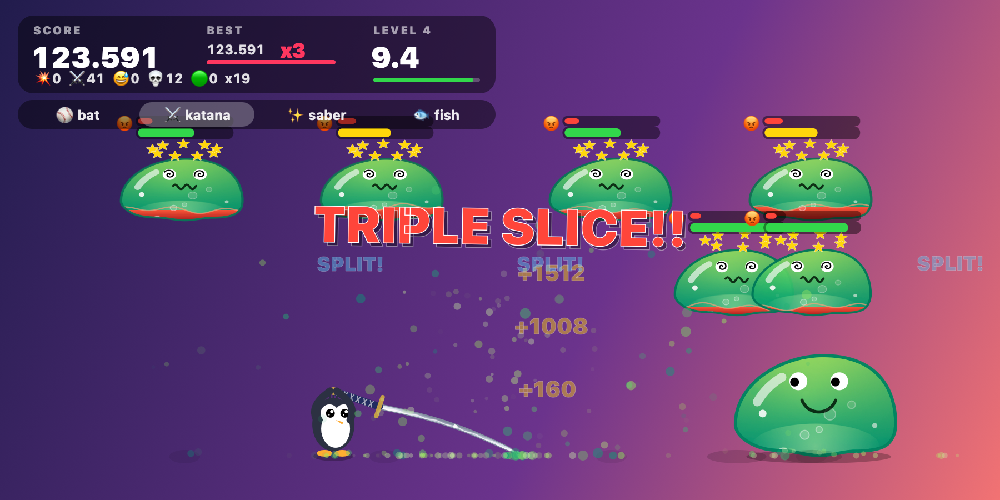
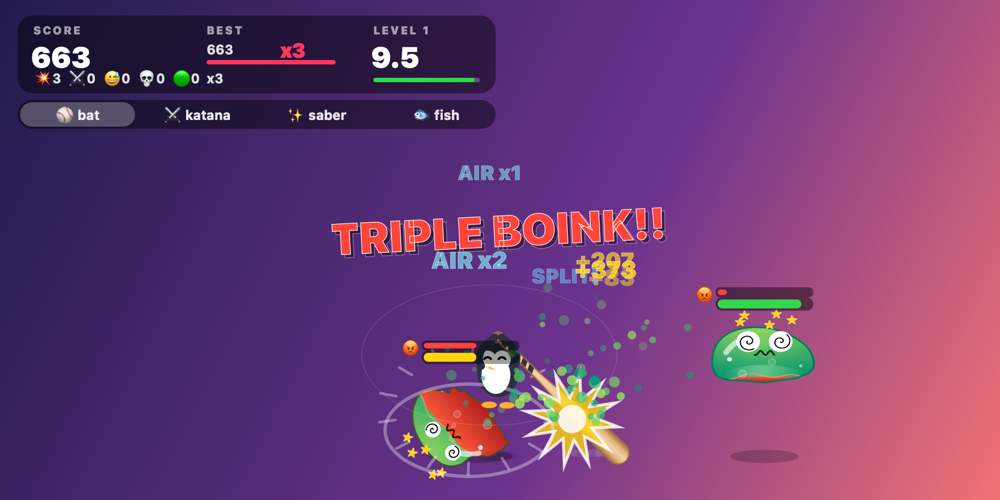
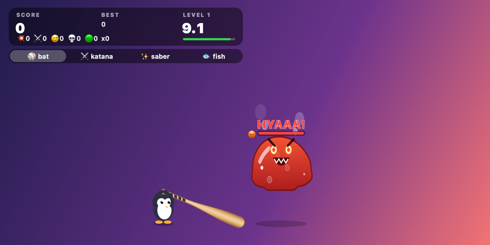

<div align="center">

# 🐧🗡️ Jelly-Smasher 🟢

### Your agent is thinking. Your hands are bored. Smash some jelly.

**A tiny, juicy desktop game for the idle seconds of vibecoding.**
It floats transparently over your editor, clicks pass straight through to your work,
and a penguin with a katana is always one grab away.



</div>

---

## ⏳ Built for the wait

You fire off a prompt. The agent goes off to think, build and run tests. You've got ~10 seconds.

That's exactly one level of Jelly-Smasher.

- 🪟 **Lives on top of your desktop.** It's a transparent, always-on-top overlay. Everything except the penguin and its weapon is click-through, so your terminal and editor keep working underneath.
- ⚡ **Zero setup.** It's one Swift file with no dependencies. Compile it and play.
- ⏱️ **10-second levels.** Clear the screen before the clock runs out, then get back to reviewing that diff.

## 💥 Why it's so satisfying

| | |
|---|---|
| 🏏 **Speed is damage** | A lazy poke tickles. A full-speed swing goes *BOINK*. Damage and knockback follow how fast the blade is actually moving. |
| 🪂 **Juggle combos** | Hard hits launch slimes into the air. Keep them airborne for AIR x2, x3… and stack up bonus damage. |
| ✂️ **Everything splits** | Every hit cuts a slime into two smaller ones, which fly apart carrying its damage. Slice, split, slice again. |
| 😡 **Slimes fight back** | Push them too far and they wind up, leap at you and spit goo that gums up your grip. |
| 📈 **It never stops** | Level N brings N slimes, each bigger and beefier than the last. Count and HP grow forever. How far can you get? |
| 🧃 **Juice everywhere** | Soft-body jelly physics, hit-stop freeze frames, screen shake, splatter, combo banners and dizzy googly eyes. |



## ⚔️ Pick your weapon

| | Weapon | Feel |
|---|---|---|
| ⚔️ | **Katana** | The starter. Long, fast, slices clean. |
| ⚾ | **Bat** | Heavy and blunt. Big launches for juggling. |
| ✨ | **Saber** | Glowing, light, whippy. |
| 🐟 | **Fish** | You know why. |



## 🚀 Play

Requires macOS and the Xcode command-line tools (`xcode-select --install`).

```sh
git clone https://github.com/piijt/Jelly-Smasher.git
cd Jelly-Smasher
swiftc -O boink.swift -o boink
./boink &
```

## 🎮 Controls

| Action | How |
|---|---|
| Swing | Grab the penguin or the weapon and fling it around |
| Switch weapon | Click the weapon bar, or right-click the penguin |
| Move the whole game | ⌥ Option-drag |
| Restart | Double-click the penguin, or right-click → Reset |
| Quit | Right-click → Quit Boink |

---

<div align="center">

**Ship code. Smash jelly. Repeat.** 🟢💥🐧

</div>
